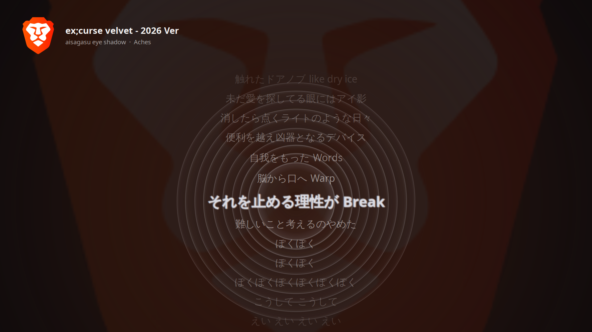

# Undertone

[](https://ko-fi.com/mohitaasirwal)
[](https://github.com/Mohit-Aasirwal/undertone/releases)
[](LICENSE)

Lyrics that live underneath your windows.

Undertone turns your desktop into a lyrics lightbox whenever music plays. It sits on the desktop layer, above the wallpaper and below every window, so it is there when you glance at an empty desktop and out of the way when you are working. Time-synced lyrics scroll with the track, the album art fades in behind them, the colours come from the cover, and the visualizer moves to the beat.



## Features

- **Any player.** Watches every MPRIS player on the session bus: Spotify (app or web), YouTube Music, VLC, Firefox, Chromium-based browsers. Allow and deny lists keep video tabs from triggering it.
- **Synced lyrics.** Local `.lrc` files, then [LRCLIB](https://lrclib.net), then NetEase, in the order you choose. Plain-lyrics fallback and a local cache.
- **Karaoke.** Enhanced LRC with word timestamps gets a word-by-word sweep across the current line.
- **Theming.** Accent colour extracted from the album cover, or taken from your GTK theme. Slow zoom on the art backdrop.
- **Beat-aware visualizer.** Concentric rings, bars, a wave or particles, driven by the system audio output with onset detection. Rings kick and the current line pulses on the beat.
- **Translations.** A faint translated line under the current lyric, in any language.
- **Runtime control.** `undertone ctl` over D-Bus: toggle, cycle visualizer, nudge lyric timing, inspect status. Bind the commands to hotkeys in your desktop's keyboard settings.
- **Screensaver mode.** After N idle minutes the lyrics rise above everything as an ambient display, then drop back when you return.
- **Lyrics editor.** `undertone lyrics` exports, shifts, retimes and tap-marks lines into a local `.lrc` that reloads live.
- **Pause screen.** A dimmed, paused lightbox lingers for a few seconds instead of vanishing.
- **Hotkeys and panel.** `--install-hotkeys` binds the controls on Cinnamon and GNOME; `--install-applet` adds a panel menu.
- **Stats.** Listening history with `undertone stats`.
- **Shared page.** A small web page mirrors the lyrics live to a phone or laptop on the same network.
- **Multi-monitor.** Each monitor gets its own box with size, aspect ratio, anchor and text scale.
- **X11 and Wayland.** Desktop-type window on X11; gtk-layer-shell background layer on Wayland.

## Install

Debian, Ubuntu, Mint: download the `.deb` from the [latest release](https://github.com/Mohit-Aasirwal/undertone/releases) and install it:

```bash
sudo apt install ./undertone_1.2.0_all.deb
```

From source on any distro with `pipx`:

```bash
git clone https://github.com/Mohit-Aasirwal/undertone.git
cd undertone
./install.sh
```

Arch: `packaging/PKGBUILD`. Flatpak: `packaging/io.github.mohitaasirwal.Undertone.yml`.

Requirements: Python 3.11+, GTK 3 bindings for Python (`python3-gi`, `gir1.2-gtk-3.0`, `python3-gi-cairo`), `numpy`, and `parec` from `pulseaudio-utils` (works with PulseAudio and PipeWire). On Wayland add `gir1.2-gtklayershell-0.1`.

Then:

```bash
undertone                       # run in the foreground
undertone --install-autostart   # start on login
undertone --list-monitors       # names and indices for the config
```

## Configure

Copy `config.example.toml` to `~/.config/undertone/config.toml`. Every option is documented in the file. The essentials:

```toml
monitors = "all"              # "primary", or ["HDMI-A-0"], or [0, 1]

[window]
width  = "fill"               # "fill", 1280, or "70%"
# ratio = "16:9"              # derive height from an aspect ratio
anchor = "center"             # top, bottom, left, right, top-left, bottom-right...
margin = 0

[window.DP-1-0]               # per-monitor override, by name or index
width = "60%"
ratio = "16:9"
anchor = "bottom-right"

[visualizer]
enabled = true
mode = "rings"                # rings, bars, wave, particles
rings = 10
opacity = 0.2
fps = 30

[font]
family = "Sans"
weight = "Bold"
scale = 1.0

[profiles.brave]              # per-player: lyric offset and art
offset_ms = -150

[playback]
pause_hold_s = 8

[theme]
source = "art"                # art, gtk, none

[players]
deny = ["firefox"]            # or allow = ["spotify", "brave"]

[lyrics]
sources = ["local", "lrclib", "netease"]
local_dirs = ["~/Music"]

[translation]
enabled = false
target = "hi"

[screensaver]
enabled = false
idle_minutes = 10

[web]
enabled = false
port = 8765
```

## Control it while it runs

```bash
undertone ctl status            # JSON: track, position, lyrics source, offsets, bpm, accent...
undertone ctl toggle            # hide or show without stopping
undertone ctl cycle-vis         # rings -> bars -> wave -> particles
undertone ctl nudge +200        # lyrics 200 ms later for this track (persisted)
undertone ctl global-offset -100
undertone stats --days 30
undertone lyrics show         # current lines with timing
undertone lyrics mark         # tap along: stamp the playback position on the next untimed line
undertone --install-hotkeys   # Super+Alt+L toggle, +V cycle, +Left/Right nudge, +M mark
undertone --install-applet    # Cinnamon applet / GNOME extension
```

These are plain D-Bus calls on `org.undertone`, so any launcher or hotkey daemon can trigger them.

## How it works

Playback state comes from MPRIS over D-Bus. Lyrics are looked up through the configured source chain and cached. The visualizer streams the default sink's monitor through `parec`, runs a 2048-sample FFT, maps it to log-spaced bands with auto-gain, and feeds the bass band to an onset detector for beats and tempo. Each monitor gets a GTK window on the desktop layer; drawing is cached in layers so two 1080p windows at 30 fps stay under 10% CPU.

## Support the project

Undertone is free, open source, and built by one person on evenings and weekends. If it has made your desktop a nicer place to be, you can keep it moving with a coffee:

<a href="https://ko-fi.com/mohitaasirwal"></a>

Every tip goes into the roadmap below. A few coffees pay for the lyrics API traffic and a month of test VMs; a lot of them pay for a second monitor and a Wayland box so the features land on every desktop, not just mine. Sponsors get their name in the release notes and a say in what ships next.

### What's next

These are the things that would make Undertone genuinely better, roughly in the order I want to ship them:

- **Flathub listing.** One-click install on every distro. The manifest exists; it needs a build box and a review cycle.
- **Wayland, verified.** The layer-shell path is written but untested on real compositors. Hyprland, Sway, KDE and GNOME each need a pass.
- **Smoother sync.** Sub-second position from players that only report once a second, by locking to the beat grid.
- **Lyrics everywhere.** More sources (Musixmatch community, Genius plain lyrics), romanisation for Japanese and Korean, and an editor to fix timing and push corrections back to LRCLIB.
- **Themes and layouts.** Font choices, a vertical layout for portrait monitors, and a compact bar mode for the top or bottom edge of the screen.
- **Visualizer packs.** A small plugin API so anyone can drop in a new mode, with spectrum, oscilloscope and album-art particle modes to start.
- **Phone companion.** The shared page as a proper PWA with remote control: skip, nudge lyrics, switch visualizer from the sofa.
- **Windows and macOS.** The core is portable; the window layer and audio capture need native backends.

If one of these matters to you, say so in a [discussion](https://github.com/Mohit-Aasirwal/undertone/discussions) or with your tip. Pull requests are very welcome, and the `help wanted` label marks the places where a second pair of hands helps most.

## Development

```bash
python3 -m unittest discover -s tests -t .
```

Pure logic lives in small modules with unit tests. For end-to-end checks without touching your own music, `tests/fixtures/fake_player.py` publishes a controllable MPRIS player, and `UNDERTONE_AUDIO_CMD` feeds the visualizer from any command that writes 48 kHz mono float32 (for example `ffmpeg -re -i track.wav -f f32le -ac 1 -ar 48000 -`).

## License

MIT
